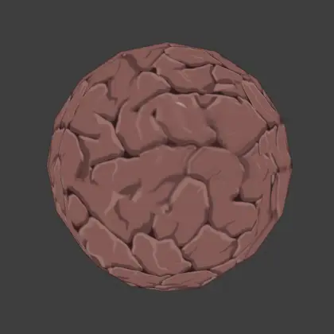

# Splencil




Paste clipboard images into Blender Texture Paint as stencils. Optional background removal uses `rembg`.

## Install

1. Download the latest `splencil-*.zip` from GitHub Releases. Do not use GitHub's generated source-code zip.
2. In Blender: Edit > Preferences > Add-ons > Install from Disk, select the zip, then enable **Splencil**.
3. For background removal: expand Splencil preferences and click **Install Dependencies**. This needs internet access and may take a while.

If dependency install fails, set **Python executable** in Splencil preferences, click **Check Dependencies**, then **Install Dependencies** again. Manual fallback:

```sh
python -m pip install Pillow numpy rembg
```
