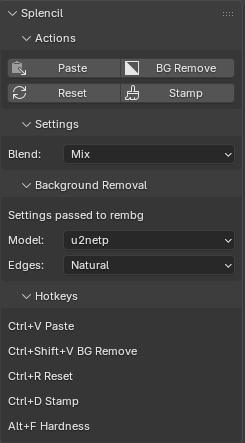

# Splencil

Paste clipboard images into Blender Texture Paint as stencils. Optional background removal uses `rembg`.

## Install

Download [repo as zip](https://github.com/metaphore/splencil/archive/refs/heads/main.zip), then Blender > Preferences > Add-ons > Install from Disk. Enable **Splencil**.

For background removal, open Splencil preferences and click **Install Dependencies**. Manual fallback: `python -m pip install Pillow numpy rembg`.

## Use

Switch to **Texture Paint**, open the 3D View sidebar with `N`, then find **Splencil**.

| Panel | Actions |
|---|---|
|  | **Paste** `Ctrl+V` Clipboard image -> stencil  **BG Remove** `Ctrl+Shift+V` Paste with background removal  **Reset** `Ctrl+R` Fit/reset stencil transform  **Stamp** `Ctrl+D` Paint the current stencil once  **Flip Horizontal** `Ctrl+Shift+H` Mirror stencil left to right; press again to restore  **Hardness** `Alt+F` Brush edge hardness |
